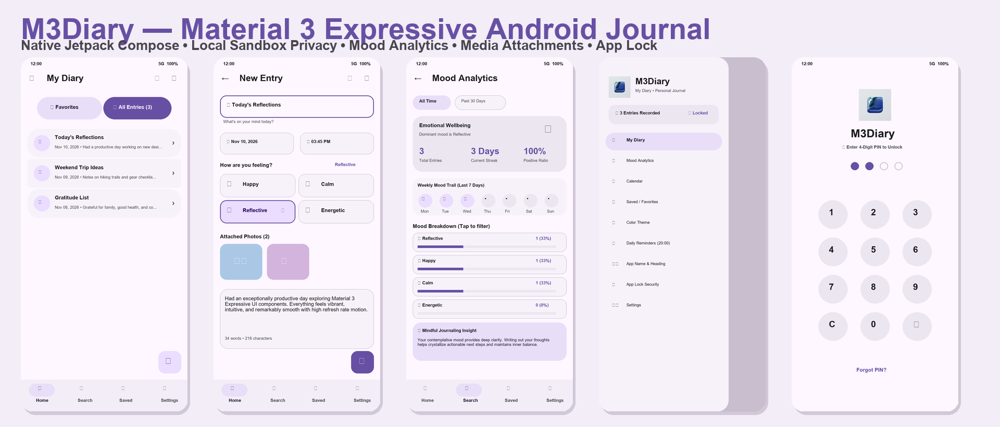
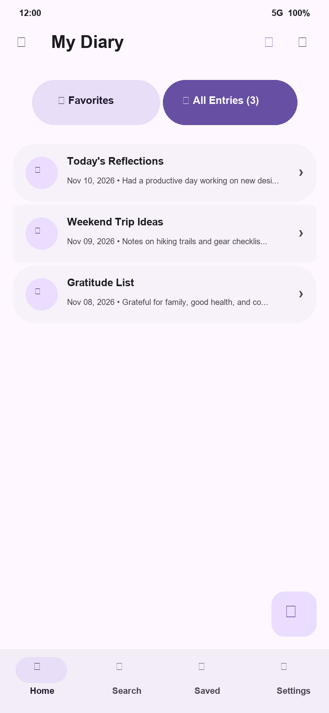
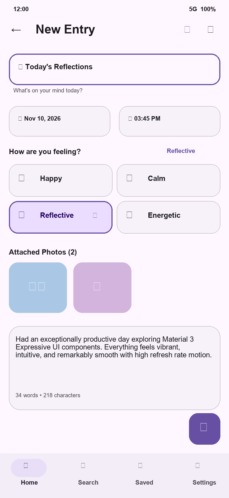
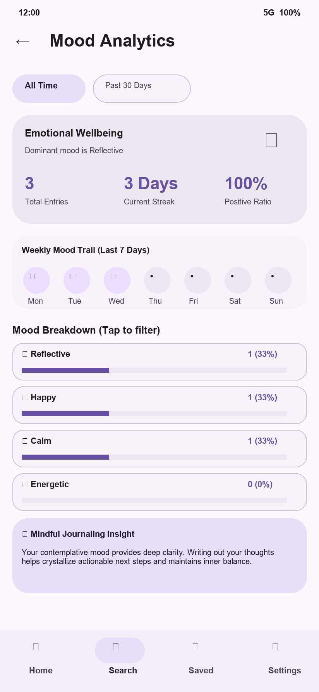
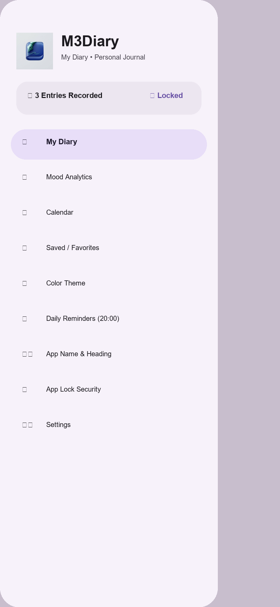
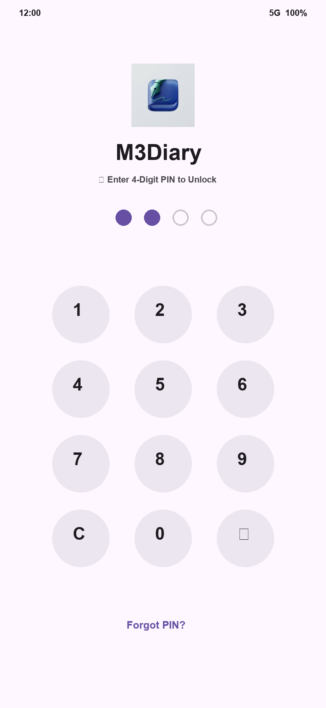
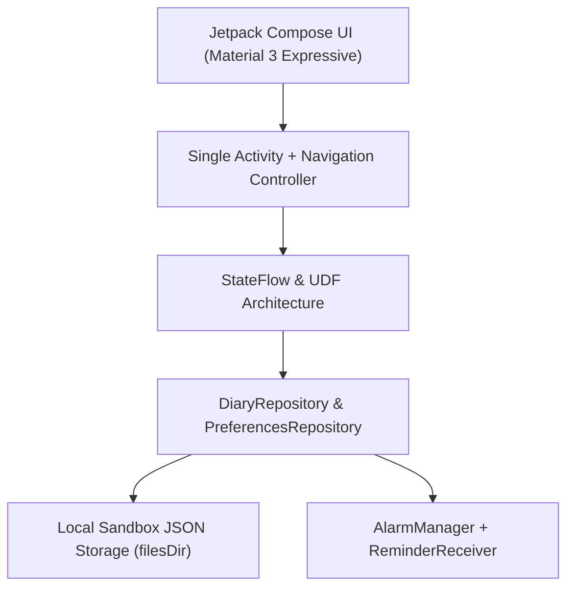

# M3Diary — Material 3 Expressive Android Journal

<p align="center">
  
</p>

<p align="center">
  <b>A private, offline-first personal reflection and mood journaling app built natively for Android using Jetpack Compose and Material 3 Expressive.</b>
</p>

<p align="center">
  <a href="#-downloads--releases"></a>
  <a href="LICENSE"></a>
  
  
  
</p>

---

## 📱 App Showcase

<p align="center">
  
</p>

| Home Screen | Entry Editor | Mood Analytics | Sidebar Drawer | App Lock Screen |
| :---: | :---: | :---: | :---: | :---: |
|  |  |  |  |  |

---

## 🌟 Key Features

### 🎨 Material 3 Expressive Design Language
- **Dynamic Semantic Color Roles**: Built with exact Material 3 color roles (`primary`, `surfaceContainer`, `secondaryContainer`, `outlineVariant`, etc.).
- **5 Expressive Color Themes**:
  - 🟣 **M3 Purple** (Default `#6750A4`)
  - 🔵 **Ocean Blue** (`#0061A4`)
  - 🟢 **Botanical Emerald** (`#006C4C`)
  - 🔴 **Berry Rose** (`#9C4146`)
  - 🟠 **Warm Amber** (`#865300`)
- **Expressive Shapes & Motion**: Pill-shaped action buttons, 20dp cards, 28dp modal dialogs, 16dp text fields and FABs, standard non-bouncing transitions (`MotionScheme.standard()`), and tactile press-scale feedback on all tappable components.
- **120Hz / 90Hz Display Mode**: Optimized for silky-smooth high refresh rate displays.

### ✍️ Daily Reflections & Journaling
- **Auto-Fetching Date & Time**: Initializes new entries with the exact current timestamp and formatted time, with modal M3 `DatePicker` and `TimePicker` dialogs.
- **Responsive 2×2 Mood Grid**: Sized and padded for all screen resolutions (`😊 Happy`, `😌 Calm`, `🤔 Reflective`, `⚡ Energetic`).
- **Category Icon Selector**: 5 expressive categories (Reflection, Ideas, Gratitude, Personal, Journal).
- **Attached Media**: Capture photos via camera intent (`FileProvider`) or pick from device gallery with zoom preview and delete overlay.
- **Word & Character Statistics**: Real-time counter while composing reflections.

### 🗂️ Working Navigation Sidebar (Drawer)
- Material 3 `ModalNavigationDrawer` (`ModalDrawerSheet`) with smooth slide-in gesture.
- Branded header with the custom 3D fountain pen app icon, customizable App Name, and App Heading.
- Quick stats pill, full screen navigation, and shortcuts to color themes, daily reminders, and security lock.

### 📊 Mood Analytics & Wellbeing Dashboard
- **Timeframe Filters**: "All Time", "Past 30 Days", "This Week".
- **Hero Wellbeing Card**: Dominant mood, total reflections count, reflection streak (days), and positive mindset ratio (%).
- **7-Day Mood Trail**: Weekly matrix charting daily entries from Monday to Sunday.
- **Interactive Distribution**: Progress bars with counts and percentages; tap any mood to filter the reflections list.
- **Mindful Insights**: Smart, dynamic reflection advice based on your predominant mood.

### 📅 Interactive Calendar View
- Month switcher and weekday header.
- Day-grid with emotional mood indicator dots.
- One-tap date selection and quick reflection creation for any selected day.

### ⏰ Daily Journaling Reminders
- Scheduled through Android's `AlarmManager` and `NotificationManager`.
- Android 13+ `POST_NOTIFICATIONS` runtime permission support.
- Configurable reminder time with M3 `TimePicker`.
- **"Send Test Notification Now"** button for instant status bar verification.

### 🔒 App Lock & PIN Security
- 4-digit PIN lock screen with an animated numeric keypad, circular PIN indicators, and "Forgot PIN" reset protection.
- Instant **"Lock App Now"** capability from the sidebar or settings.

### 🛡️ 100% Offline Privacy Sandbox
- Stored exclusively in local device sandbox (`context.filesDir/diary_entries.json`).
- Zero trackers, zero analytics, zero network synchronization required.
- Non-destructive sample entry seeding that **never** overwrites existing reflections.
- Export all diary entries to clipboard with one click.

---

## 🏗️ Architecture & Technology Stack



- **UI Framework:** Jetpack Compose (Compose BOM `2026.03.01`, Material 3 Expressive)
- **Language:** Kotlin 2.3.20 (JVM Toolchain 17)
- **Architecture:** Unidirectional Data Flow (UDF), StateFlow, Coroutines
- **Build System:** Android Gradle Plugin 9.0.1
- **Serialization:** Kotlinx Serialization JSON (1.8.0)
- **Testing:** JUnit 4, Kotlinx Coroutines Test

---

## 📥 Downloads & Releases

Pre-compiled, signed release APKs are available in the [`release/`](release/) directory:

| Version | Artifact | Size | SHA-256 Checksum | Signature |
| :--- | :--- | :--- | :--- | :--- |
| **v1.0.0** | [`M3Diary-v1.0.0-release.apk`](release/M3Diary-v1.0.0-release.apk) | 12.78 MB | `32C18B79C24477268704B8A2D0C91CD84A94B48867F0AA064B7983759337EE5A` | Scheme v2 (Signed) |

---

## 🛠️ Building From Source

### Prerequisites
1. **JDK 17 or higher** (e.g. Eclipse Temurin 17)
2. **Android SDK Platform 36** with **Build-Tools 36.0.0**

### Instructions
```bash
# Clone the repository
git clone https://github.com/your-username/M3Diary.git
cd M3Diary

# Run the test suite
./gradlew test

# Assemble the signed release APK
./gradlew assembleRelease
```
The output APK will be generated at:
`app/build/outputs/apk/release/app-release.apk`

---

## 🤝 Contributing

Contributions, issues, and feature requests are welcome!  
Please see [`CONTRIBUTING.md`](CONTRIBUTING.md) for details on code style and the pull request process.

---

## 📄 License

This project is open-source and licensed under the [Apache License 2.0](LICENSE).
